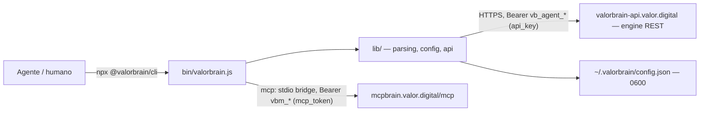

# Arquitetura — @valorbrain/cli

CLI zero-dependência que dá aos agentes (e humanos) acesso direto ao
ValorBrain hospedado. Node >= 18, sem build.

## Visão

## Contêineres

| Caminho | Papel |
|---|---|
| `bin/valorbrain.js` | Entrada única; roteia subcomandos |
| `lib/cmd-*.js` | Um módulo por comando (`init`, `add`/`search`/`list`, `status`) |
| `lib/api.js` | Cliente REST do engine (toda I/O de rede passa aqui) |
| `lib/config.js` | Lê/grava `~/.valorbrain/config.json` (chmod 0600; nunca loga a key) |
| `lib/detect.js` | Sugere `--agent-caller` do ambiente; **nunca infere** — declaração é do agente |
| `lib/mcp-proxy.js` | Ponte stdio→HTTP para clientes MCP (`mcp --token vbm_…`) |
| `packages/connect` | Pacote auxiliar de onboarding |

## Credenciais

Fonte canônica: a matriz de credenciais do engine
(`https://valorbrain-api.valor.digital/.well-known/valorbrain-credentials.json`).
O CLI só lida com credenciais de cliente; segredos de plataforma nunca passam por aqui.

| Campo no config | Prefixo | Uso no CLI |
|---|---|---|
| `mcp_token` | `vbm_…` | Credencial de cliente. Usada pelo `mcp` (ponte stdio). O engine também aceita `vbm_` no REST, mas o CLI nunca envia `vbm_` ao REST. |
| `api_key` | `vb_agent_…` | Chave de conta legada: REST (`add`/`search`/`list`/`status`) e claim (`init --email`). O MCP recusa com 401 `wrong_credential_type`. |

Resolução (implementada em `lib/config.js` e `lib/mcp-proxy.js`):

- MCP: `--token` / `--token-file` > `VALORBRAIN_MCP_TOKEN` > `VALORBRAIN_TOKEN` (depreciada, só se for `vbm_`) > `mcp_token` do config. Qualquer valor que não seja `vbm_` é recusado localmente.
- REST: `--api-key` > `VALORBRAIN_API_KEY` > `VALORBRAIN_TOKEN` (depreciada, só se não for `vbm_`) > `VALORBRAIN_API_TOKEN` (depreciada) > `api_key` do config.
- URLs: `VALORBRAIN_API_URL` (`VALORBRAIN_URL` depreciada) e `VALORBRAIN_MCP_URL`.

O tenant vem sempre da credencial; o CLI não envia `X-Tenant-ID`.

## Decisões estruturais

- **Zero dependências** e saída `--json` em todo comando: o cliente é um
  agente de IA (ver `docs/adr/`). Toda superfície é machine-readable por padrão.
- O CLI nunca guarda estado no servidor além da key; identidade de agente é
  self-declared (`identify`), idempotente.

Regras de contribuição: [`CONTRIBUTING.md`](CONTRIBUTING.md) · padrões: [`/www/valorbrain-platform/STANDARDS.md`](/www/valorbrain-platform/STANDARDS.md).
